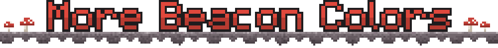
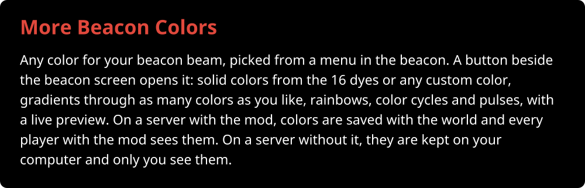
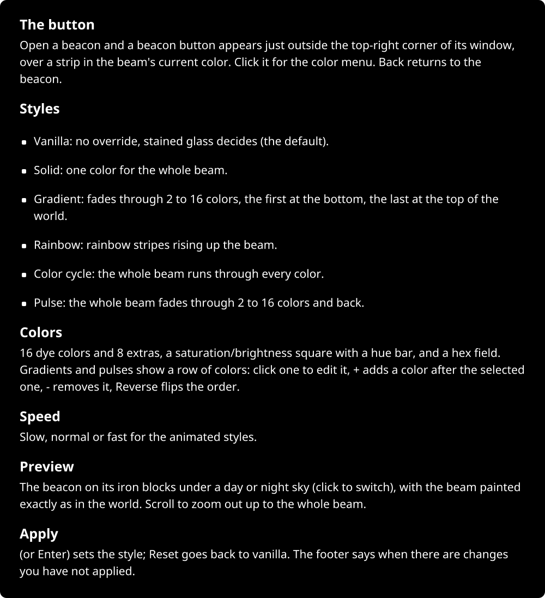
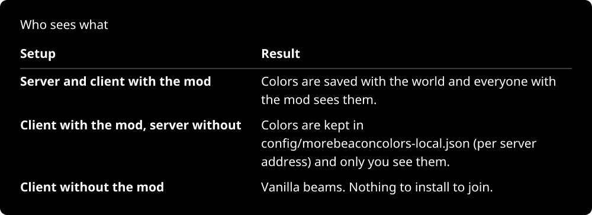
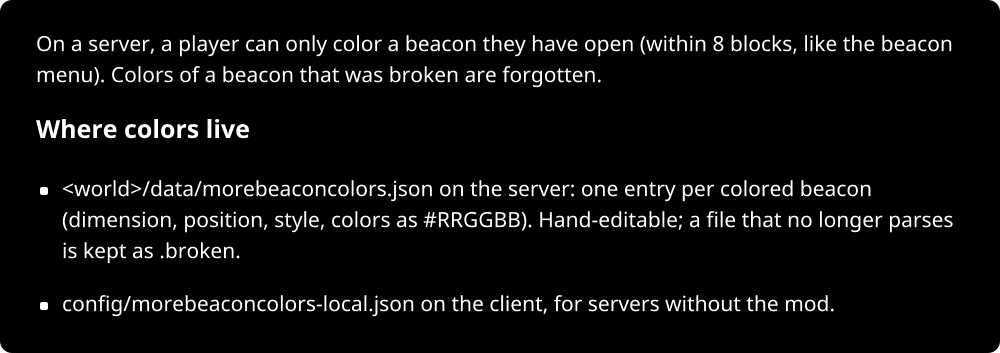
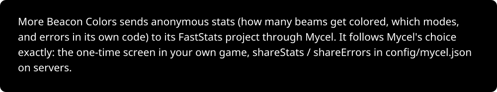
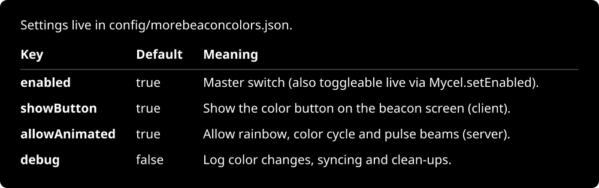
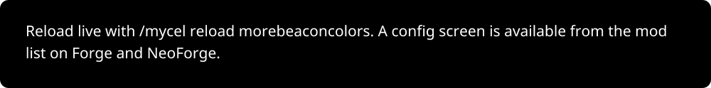

  

  
  
  
  
  
  
  
  

/data/morebeaconcolors.json on the server: one entry per colored beacon (dimension, position, style, colors as #RRGGBB). Hand-editable; a file that no longer parses is kept as .broken. config/morebeaconcolors-local.json o" width="100%">

